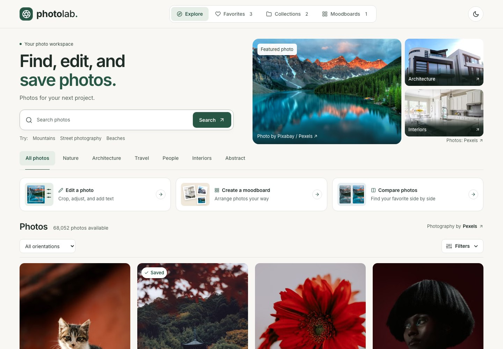
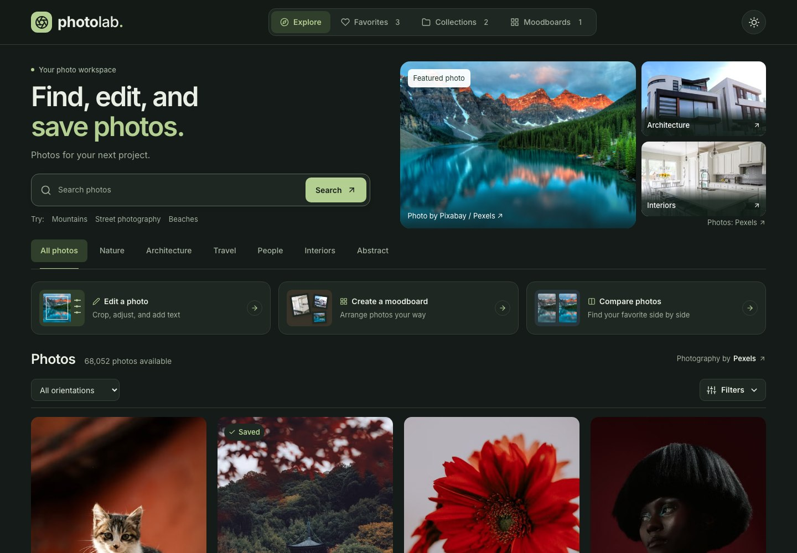
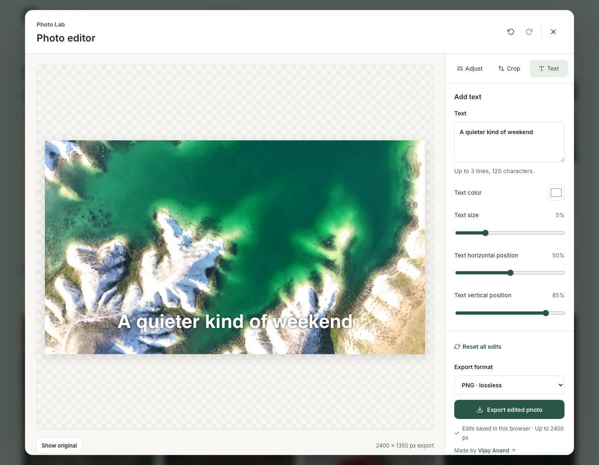
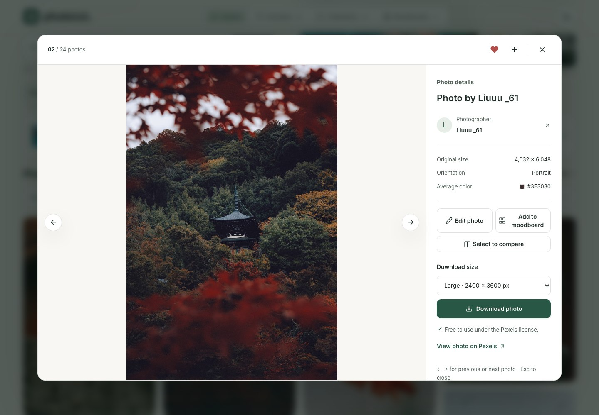
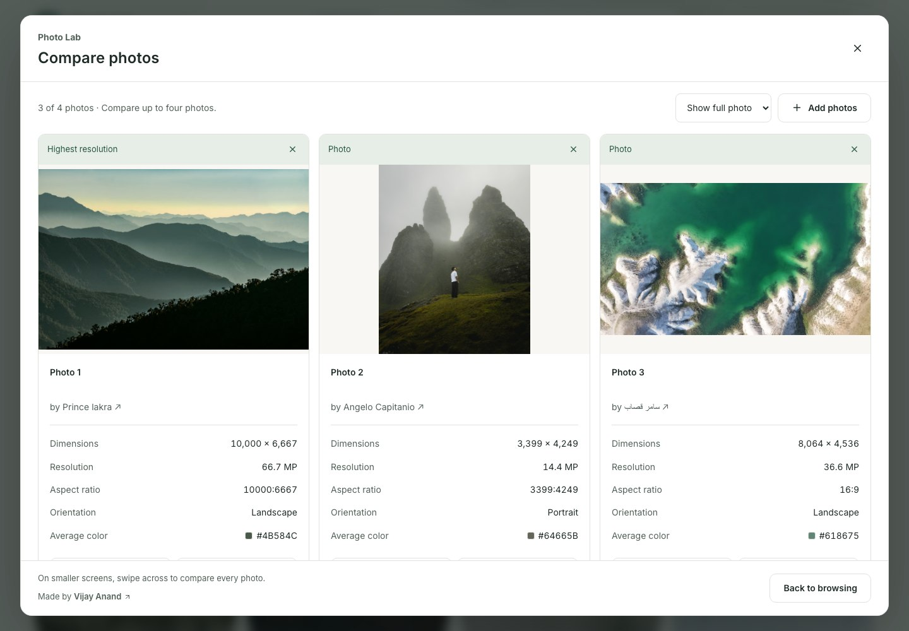
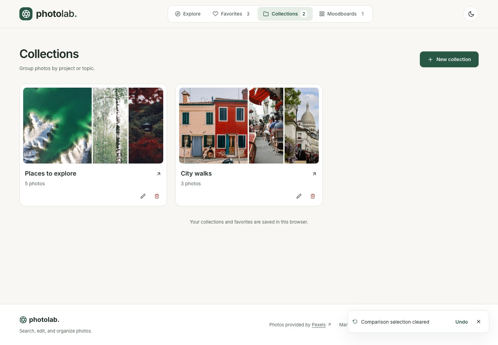
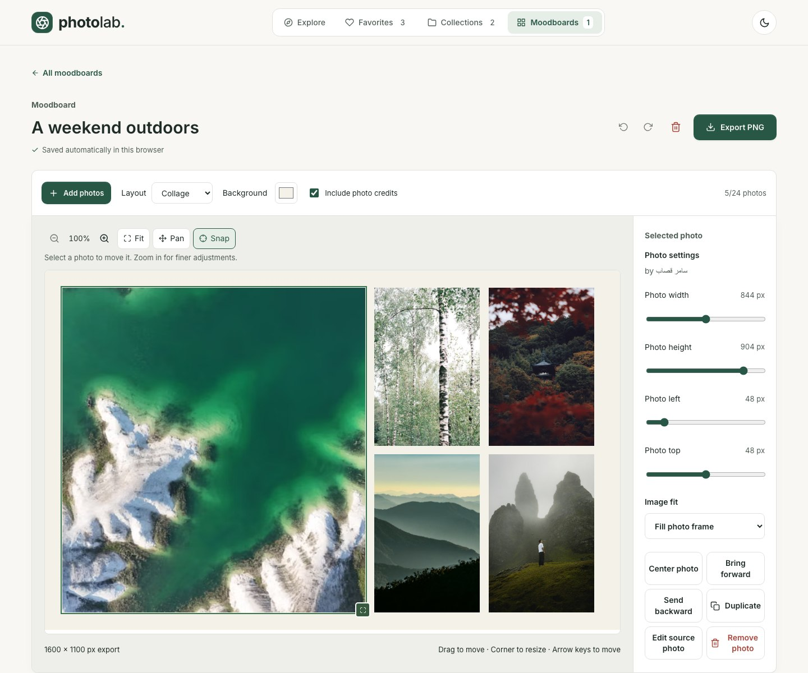
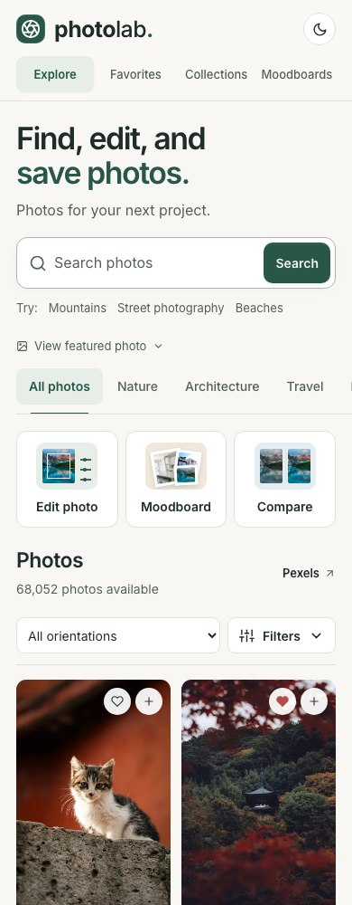
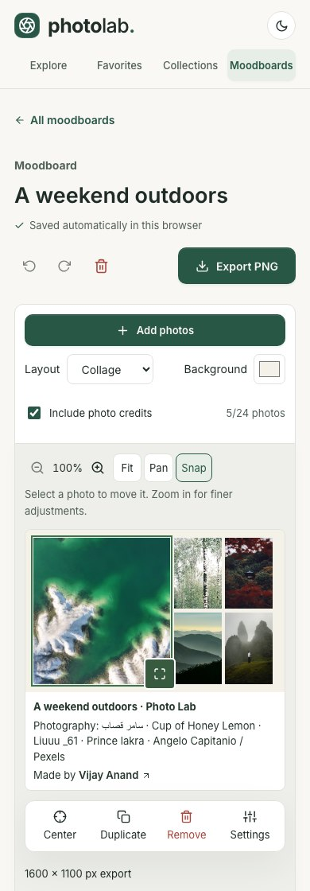
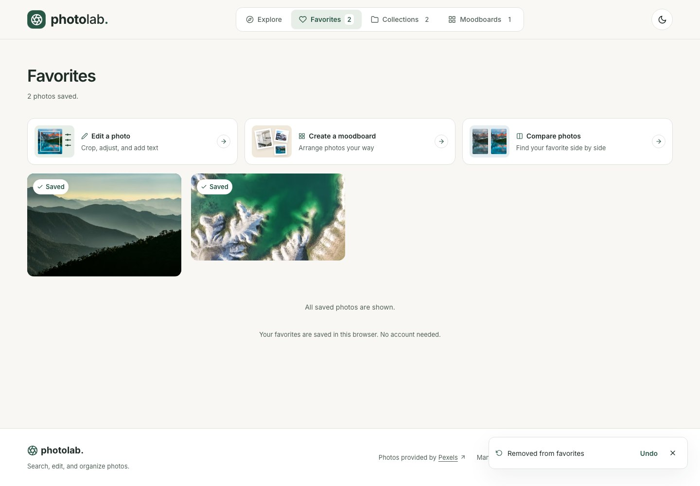

# Photo Lab

Discover photos, save ideas, and turn them into something you can use. Photo Lab is a responsive React workspace for browsing Pexels photography, editing images, building moodboards, and comparing photos side by side.

Made, managed, and maintained by [Vijay Anand](https://github.com/vijayanand1505).



[Quick start](#quick-start) · [Screenshots](#screenshots) · [Video walkthroughs](#video-walkthroughs) · [Features](#features) · [Using the tools](#using-the-tools) · [Storage and limits](#storage-and-limits) · [Development](#development)

## Quick start

You will need Node.js 18 or newer, npm, and a [Pexels API key](https://www.pexels.com/api/).

```sh
git clone https://github.com/vijayanand1505/Photo-Lab.git
cd Photo-Lab
npm ci
```

Create `.env.local` in the project root and add your key:

```dotenv
REACT_APP_SECRET_KEY=your_pexels_api_key
```

Then start the app:

```sh
npm start
```

Open [localhost:3000](http://localhost:3000). Restart the development server whenever you change environment variables. An existing `.env` containing the same variable also works; keep real keys out of version control.

Local development uses `REACT_APP_SECRET_KEY`. Production photo requests go through the Vercel function at `/api/photos`, which reads the server-only `PEXELS_API_KEY` variable. Do not add a `REACT_APP_*` key to Vercel.

## Screenshots

These screenshots show the running application with real Pexels photographs. Collections and moodboards contain sample projects prepared for this documentation. Click an image to view it at full size.

| Discover and organize | Edit and compare |
| --- | --- |
| **Dark theme**<br>[](docs/images/home-dark.jpg) | **Photo editor**<br>[](docs/images/photo-editor.jpg) |
| **Photo viewer**<br>[](docs/images/photo-viewer.jpg) | **Photo comparison**<br>[](docs/images/photo-comparison.jpg) |
| **Collections**<br>[](docs/images/collections.jpg) | **Moodboard builder**<br>[](docs/images/moodboard.jpg) |

<details>
<summary>Mobile layouts and removal recovery</summary>

<p>
  <a href="docs/images/mobile-gallery.jpg"></a>
  <a href="docs/images/mobile-moodboard.jpg"></a>
</p>



</details>

## Video walkthroughs

Click a preview to open or download its WebM recording. The videos are silent recordings of the app in use.

| Photo tools | Moodboard workflow |
| --- | --- |
| [](docs/videos/photo-tools-walkthrough.webm) | [](docs/videos/moodboard-walkthrough.webm) |
| [Watch photo tools · 40 seconds](docs/videos/photo-tools-walkthrough.webm): switch themes, inspect a photo, save to a collection, adjust and crop an image, add text, export, and compare photos. | [Watch moodboards · 25 seconds](docs/videos/moodboard-walkthrough.webm): create a board, add photos, apply a collage layout, zoom and pan, undo a removal, and export a PNG. |

See the [media notes](docs/MEDIA.md) for recording details and photo credits. Gallery results may change as Pexels updates its catalog.

## Features

### Photo discovery

- Curated photography from Pexels, plus search that runs when you submit a query.
- Search suggestions and shortcuts for Nature, Architecture, Travel, People, Interiors, and Abstract.
- Orientation filtering for landscape, portrait, and square photos.
- An expandable **Filters** panel for image size and eight color choices, with an active filter count, removable chips, and **Clear all**.
- A compact search results header and a featured photo that can be expanded or collapsed on mobile.
- Responsive masonry gallery with reserved image space, responsive image sources, lazy loading, and image retry controls.
- **Load more** pagination with duplicate removal and stable placement of existing photos.
- Cancellation of outdated requests, loading skeletons, empty states, and retryable errors for failed requests.

### Favorites and collections

- Save or remove favorites with a heart button and a clear saved state.
- Create, rename, and delete named collections; add or remove photos through the collection picker.
- Collection covers, photo counts, and library navigation counts.
- Favorites and collections remain available after a reload in the same browser, without signing in.
- Confirmation before deleting a collection, plus a separate Undo notice after removal.

### Photo viewer and downloads

- A large preview that fits portrait, landscape, and square photos, with previous/next navigation.
- Photographer links, original dimensions, orientation, and average color.
- Direct actions for favorites, collections, editing, moodboards, and comparison.
- Small, medium, large, and original download options, limited by the source image dimensions.
- Download progress when the image server supplies a content length, cancellation, and error feedback.
- Keyboard navigation, focus management, Escape/backdrop dismissal, and a scrollable details panel on desktop.

### Share photos

- Share from the photo viewer or a photo card’s **… → Share photo** action.
- Copy a Photo Lab link or choose **Share via…** to use your device’s sharing menu when supported.
- Links use `?photo=PHOTO_ID` and open the original photo inside Photo Lab, including in a fresh browser session. Recipients can save, edit, or download it without an account.
- Loading, retry, invalid-link, and unavailable-photo states help recipients recover from failures.
- If clipboard access is unavailable, the link is selected for manual copying.
- Sharing sends the original photo; editor drafts, personal collections, and moodboards stay in your browser. Export edited images or moodboards to share those files.

Use links from the hosted site when sharing with other people; local development links point to your own localhost.

### Lightweight photo editor

- Live canvas preview with brightness, contrast, and saturation controls from 0–200%.
- Black-and-white and Soft light presets, an original preview toggle, and **Reset all edits**.
- Original, square (1:1), portrait (4:5), and landscape (16:9) crop presets, with crop size and position controls.
- Rotation in 90-degree steps and horizontal flip.
- Text overlays with color, size, and position controls; up to three lines and 120 characters.
- Undo/redo through toolbar buttons and keyboard shortcuts, with up to 60 history entries.
- Automatically remembered settings for the 12 most recently edited photos.
- PNG or JPEG export, up to 2400 pixels on the longest edge without upscaling the cropped source.
- Saved/temporary status, image load recovery, and a brief export confirmation.

### Moodboard builder

- Multiple named boards with automatic saving in the current browser.
- Up to 24 photos per board, chosen from the current gallery, favorites, or collections.
- Freeform, grid, and collage layouts on a 1600 × 1000 canvas, with a background color control.
- Drag to move, resize from the corner, or use the inspector for precise position and size changes.
- Full-photo or filled-frame image fit, centering, duplication, and layer ordering.
- Keyboard movement, larger movement steps with Shift, removal shortcuts, and undo/redo.
- Zoom from 100% (fit width) to 300%, **Fit**, and explicit touch/mouse **Pan** mode.
- Optional snapping with alignment guides for canvas edges, centers, and nearby photos.
- Larger resize handles and a compact mobile toolbar for **Center**, **Duplicate**, **Remove**, and **Settings**.
- PNG export at 1600 × 1000, or 1600 × 1100 with the optional photographer and project credit footer.
- Export cancellation, retryable errors, and confirmation. Failed image loads prevent an incomplete export.

Zoom, panning, and alignment guides affect the workspace view; they do not change the exported canvas size.

### Photo comparison

- Compare two to four photos side by side.
- A floating selection bar with thumbnails, a selection count, and a clear action.
- Dimensions, megapixels, aspect ratio, orientation, average color, and a highest-resolution marker.
- Switch between showing the full photo and filling its frame.
- Favorite, edit, add, and remove photos from the comparison view.
- Horizontal scrolling on narrow screens and Undo for individual removals or a cleared selection.

### Recovery, continuity, and feedback

- Undo accidental removal of favorites, collection photos, entire collections, moodboards, moodboard photos, and comparison selections.
- Removal notices remain available for 12 seconds, pause while hovered or focused, and can recover recent removals separately.
- Recovery preserves later additions and edits and respects photo limits when restoring items.
- Remember browsing positions while moving between Explore, Favorites, collection lists and individual collections, and moodboard lists and workspaces during the current visit.
- Keep loaded gallery pages, search, and filters when switching sections. A new search or filter change starts at the top.
- Helpful tooltips, loading and saved states, and short export confirmations.

### Responsive interface and accessibility

- Remembered light and dark themes, warm neutral surfaces, and forest-green accents.
- Inter typography with 16px body text, 14px controls, and 13px secondary text.
- Compact homepage, preview cards for each creative tool, and shorter mobile labels: **Edit photo**, **Moodboard**, and **Compare**.
- Smaller favorite/add icons on mobile, with photographer captions below photos on touch screens.
- Keyboard focus styles, skip navigation, labeled controls, dialog focus handling, and reduced-motion support.
- Photographer attribution and footer credits, with links on **Pexels** and **Vijay Anand**.

## Using the tools

### Edit a photo

1. Choose **Edit a photo** above the gallery, or use a photo's **…** menu or viewer action.
2. Pick a photo from the current gallery, favorites, or collections. The chooser searches these available photos by description or photographer.
3. Use **Adjust**, **Crop**, and **Text** to make changes. Toggle **Show original** to check your work, and use Undo/Redo as needed.
4. Choose PNG or JPEG, then select **Export edited photo**.

Drafts store editing settings. Export creates a separate image; an editor draft does not replace the original photo or a moodboard's source image.

### Share a photo

1. Open a photo and choose **Share photo**, or choose it from the photo card’s **…** menu.
2. Select **Copy link** or **Share via…** if your device supports it.
3. Send the link to your recipient. It opens that exact photo in Photo Lab without requiring your saved library or search results.

### Build a moodboard

1. Choose **Create a moodboard**, or open **Moodboards → New moodboard**.
2. Give the board a name and select **Add photos**.
3. Pick a layout, then move or resize photos. Select a photo to use its settings, image-fit options, and layer controls.
4. On mobile, zoom for closer work, enable **Pan** to move around the canvas, and use **Fit** to return to the full width.
5. Choose whether to include photo credits, then select **Export PNG**.

Boards save automatically in this browser. The save indicator reports when browser storage is unavailable and changes are temporary.

### Compare photos

1. Open **Compare photos → Add photos**, or select photos for comparison from their **…** menus or preview actions.
2. Select two to four photos and open **Compare** from the floating selection bar.
3. Check framing, dimensions, and resolution; use **Show full photo** or **Fill frame** to change the view.
4. Favorite a choice or open it directly in the editor.

## Keyboard controls

| Context | Key | Action |
| --- | --- | --- |
| Photo viewer | Left / Right arrow | Previous / next photo |
| Dialogs and expanded filter panel | Escape | Close the active dialog or panel |
| Editor and moodboard | Ctrl/Cmd + Z | Undo an edit |
| Editor and moodboard | Ctrl/Cmd + Shift + Z | Redo an edit |
| Selected moodboard photo | Arrow keys | Move by 10 canvas pixels |
| Selected moodboard photo | Shift + arrow keys | Move by 40 canvas pixels |
| Moodboard, outside text fields | Delete / Backspace | Remove the selected photo |
| Buttons and dialogs | Tab / Shift + Tab | Move keyboard focus |

Typing fields retain their normal text undo behavior. To restore an accidental removal, use the separate **Undo** notice while it is available.

## Storage and limits

| Data | Where it lives | Lifetime |
| --- | --- | --- |
| Favorites and collections | Browser localStorage | Until removed or site data is cleared |
| Moodboard names, layouts, and photo references | Browser localStorage | Until removed or site data is cleared |
| Editor settings | Browser localStorage | The 12 most recently edited photos |
| Theme preference | Browser localStorage | Until changed or site data is cleared |
| Search, filters, loaded gallery pages, browsing positions, and comparison selection | App memory | Current app visit; resets on reload |
| Edit history and removal recovery | App memory | Active tool session / short removal recovery window |
| Exported images | Your download location | Managed by you |

Photo Lab works without user accounts. Its Vercel API function forwards photo discovery requests; personal data stays in the browser. There is no cloud sync, public board sharing, or personal photo upload. Browser storage contains settings and remote photo references, rather than an offline photo library. Saved items still need their image URLs to remain available.

Image editing and moodboard exports run in the browser using canvas. Remote images need network access and permission to be used in a canvas. If an image cannot load, retry the operation after checking your connection. The app reports storage failures and keeps changes available for the current visit when possible.

## Development

### Stack

- React 18 and React Context for the interface and shared state.
- Create React App / `react-scripts` 5 for development and production builds.
- Sass for responsive layouts and theme styling; React Icons for interface icons.
- Pexels API for photo discovery and image URLs.
- Canvas API for image adjustments, text rendering, and moodboard exports.
- localStorage for local libraries, boards, drafts, and preferences.
- Jest and React Testing Library for automated tests.

### Commands

| Command | Purpose |
| --- | --- |
| `npm ci` | Install dependencies from the lockfile |
| `npm start` | Run the development server |
| `npm test` | Run tests in watch mode |
| `CI=true npm test -- --watchAll=false --runInBand` | Run the full test suite once |
| `npm run build` | Create the production build in `build/` |

The tests cover submitted search and filters, cancellation, pagination and retries, favorites and collections, photo viewing and downloads, theme persistence, editor history and drafts, crop geometry and pixel adjustments, moodboard layout and bounds, comparison metadata, removal recovery, browsing position, alignment snapping, shared-photo loading, clipboard fallback, and native sharing.

### Deploy to Vercel

Import `vijayanand1505/Photo-Lab` into Vercel using the Create React App preset. `vercel.json` configures `npm run build` and the `build/` output directory. Use Node.js 24.

Add `PEXELS_API_KEY` as an encrypted environment variable for Production and Preview, then deploy the `main` branch. The `/api/photos` function forwards curated, search, and individual photo requests to Pexels and caches successful responses briefly. The key stays on the server. Local `.env` files are excluded from Git and CLI uploads.

Deploy the complete project, including `api/photos.js`; serving only `build/` will not provide photo discovery. Run `node --test tests/photos-api.test.cjs` to check the API handler.

### Project structure

```text
Photo-Lab/
├── public/                       # HTML entry point, app icons, and manifest
├── src/
│   ├── App.js                    # App providers and page composition
│   ├── App.scss                  # Main interface and theme styles
│   ├── components/
│   │   ├── Banner/               # Homepage hero and search
│   │   ├── Card/                 # Gallery photo cards
│   │   ├── CardContainer/        # Gallery sections and pagination
│   │   ├── Collections/          # Collections and photo picker
│   │   ├── Filters/              # Orientation, size, and color filters
│   │   ├── LightBox/             # Photo viewer and download controls
│   │   ├── Studio/               # Editor, moodboards, comparison, and canvas logic
│   │   └── shared/               # Dialogs, images, tooltips, credits, and Undo notice
│   ├── pages/Home/               # Main workspace
│   ├── styles/                   # Workspace and canvas styles
│   └── utils/                    # API, app state, storage, recovery, and scroll hooks
├── docs/
│   ├── images/                   # Desktop and mobile screenshots
│   ├── videos/                   # Recorded WebM walkthroughs
│   └── MEDIA.md                  # Media details and photography credits
└── package.json
```

### Troubleshooting

| Problem | What to check |
| --- | --- |
| Photo service cannot authorize a request | Set `REACT_APP_SECRET_KEY` in `.env.local`, check the Pexels key, and restart the development server. |
| Photo request limit reached | Wait before retrying; the API applies request limits. |
| Photos fail to load | Check your connection and retry. Saved entries still use remote image URLs. |
| Changes are marked temporary or disappear after reload | Browser storage may be blocked or full. Allow site storage; clearing site data removes saved libraries and drafts. |
| An image or moodboard will not export | Let all source images finish loading, check the reported error, and retry. Remote image access is required for canvas export. |
| Photo discovery fails after deployment | Set the server-only `PEXELS_API_KEY` in Vercel and redeploy. Keep `api/photos.js` in the deployment. |

## Credits

Made, managed, and maintained by [Vijay Anand](https://github.com/vijayanand1505).

Photography is provided by [Pexels](https://www.pexels.com), with photographer attribution in the app. See the [Pexels license](https://www.pexels.com/license/) and [API documentation](https://www.pexels.com/api/documentation/) for usage details. Documentation photo credits are listed in [the media notes](docs/MEDIA.md).
